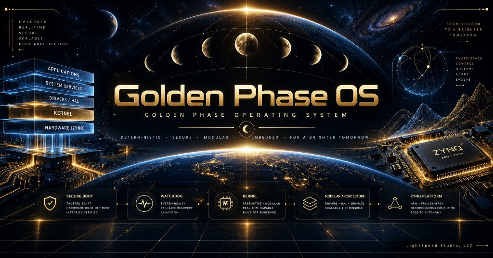

# Golden Phase Operating System (GPOS)



**gφlden phase φpertating system** — hosted runtime, RISC-V and Zynq-7000 (PZ7020) bare-metal.

This repository **is** Golden Phase Operating System. The Cargo package name remains `kairos` for build stability. Formerly referred to as “KairOS.”

**License:** dual policy in [`LICENSE.md`](LICENSE.md) (AGPLv3-only Path A, or commercial Path B). Full AGPLv3 text: [`LICENSE-AGPL-3.0.txt`](LICENSE-AGPL-3.0.txt). Ownership: [`COPYRIGHT_NOTICE`](COPYRIGHT_NOTICE).

PZ7020 board port: [`README_PZ7020.md`](README_PZ7020.md).

## Author & copyright

**Founder and sole human author:** Richard Careaga (Metatron Research / Light Speed Studio). Golden Phase mathematics, kernel architecture, and GPOS direction.

Assistive tools (Cursor, ChatGPT, Claude, and similar) are not authors and are not co-founders.

**Milestone (2026-07-07):** 314 tests passed · baremetal `kairos_boot` 557 KB (full tier) · hosted binaries ~4–5 MB · see `docs/HARDWARE_MEASUREMENTS.md` and `docs/KAIROS_BOARD_V1_REQUIREMENTS.md`.

---

## Terminology

| Term | Meaning |
|------|---------|
| **Golden Phase Operating System / GPOS** | The OS product |
| **gφlden phase φpertating system** | Stylized product line |
| **Kairos States** | The four discrete algebra values: Kairos0..Kairos3 (internal enum still `Phi0..Phi3`) |
| **Kairos** | Opportune-moment clock / StateClock sector (not the OS name) |

## Terminal Commands

The `gpos>` shell is the main development interface. Type `help` for the full list.

| Command | Description |
|---------|-------------|
| `help` | List all commands with one-line descriptions |
| `about` | Print The Zen of Golden Phase Operating System |
| `whoami` | Authority mode (root / anom) and visibility |
| `host` | Machine identity, devices, and NIC summary |
| `clear` | Clear the terminal screen |
| `version` | Print GPOS version and build target |
| `state` | Kernel summary, active Kairos State, uptime ticks |
| `regs` | VM register file (if a program has run) |
| `ps` | Process list: PID, name, Kairos State, ticks, status |
| `spawn <name>` | Create a named test process; prints new PID |
| `kill <pid>` | Stop a process by PID |
| `trace` | Recent kernel events |
| `isa` | Instruction set reference table |
| `run` | Paste a program; end input with `.end` |
| `run <program>` | Run a built-in named program (e.g. `hello`) |
| `dump` | Combined state, processes, registers, trace |
| `mem` | Memory page Kairos State tags |
| `log` | Topology reflection log |
| `exit` | Leave the shell |

Operator console (hosted `std` build): `dashboard`, `top`, `watchdog`, `phase`, `topo`, `root`, `audit`, `checkpoint`.

### Paste-and-run example

```
gpos> run
paste Golden Phase program, end with .end
LOAD A KAIROS1
LOAD B KAIROS1
COMPOSE C A B
PRINT C
HALT
.end
```

(Assembler still accepts `PHI1` / `phi1` as aliases.)

### Build and run

```bat
cargo test
cargo run --bin kairos_host
scripts\boot-qemu.bat
```

See `docs/terminal_demo.txt` for a sample session transcript.

## Documentation

| Document | Description |
|----------|-------------|
| `docs/ROADMAP.md` | **6-month plan cross-check + updated timeline** |
| `docs/kairos_whitepaper.html` | Architecture whitepaper |
| `docs/HARDWARE_MEASUREMENTS.md` | Measured ROM/RAM, benchmarks, test gate |
| `docs/KAIROS_BOARD_V1_REQUIREMENTS.md` | Board v1 hardware spec |
| `docs/AI_PHASE_TRACE.md` | Observable AI artifact → Kairos State traces |
| `docs/RACE_PHASE_TRACE.md` | Race-condition phase-trace POC |
