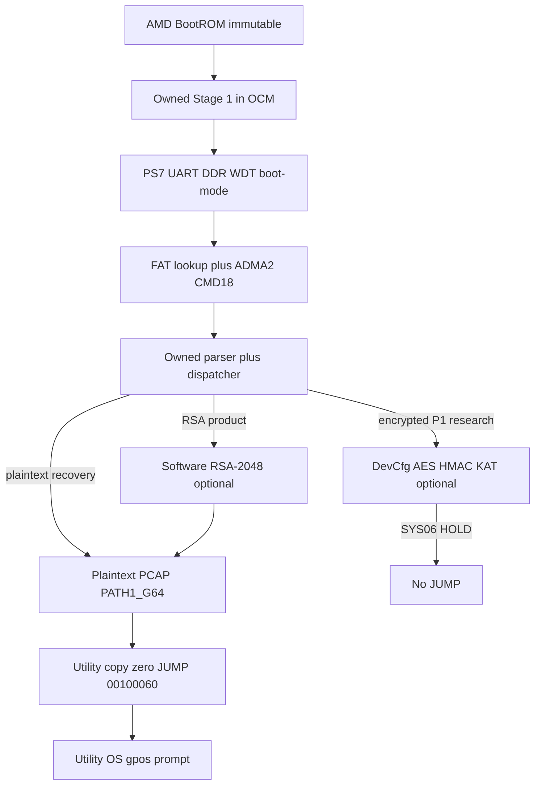

<!-- Copyright LightSpeed Studio LLC -->
<!-- SPDX-License-Identifier: AGPL-3.0-only OR LicenseRef-GPOS-Commercial -->

# LightSpeed Studio LLC — Stage 1 technical overview

Owned post-ROM boot on AMD Zynq-7000 (XC7Z020, PZ7020-SL-C). Device crate `zynq_stage1_owned` has no `[dependencies]`. Shortcut `zynq_stage1/src/main.rs` SHA-256 `6637678d0e01b007caf3b5e150ed37e48ed5af6f55cc009a3b16e0d5c4ebd67d` (9580) is the behavioral reference and is not edited by Systems 3–12.

## Boot flow

## AMD BootROM boundary

BootROM is AMD silicon. It loads partition 0 from SD `BOOT.BIN` into OCM and jumps to Stage 1 `e_entry` (`0x00000000` on owned ELFs). LightSpeed Studio LLC does not replace BootROM. BootROM RSA stays **not eFuse-enforced** on this research board (`BOOTROM RSA2048 STAGE1 status=NOT_ENFORCED` on SYS10A UART).

## Owned Stage 1 entry

`owned/src/start.S` then `sys10a::rust_main` (unified ELF) or earlier `sys0N` entries. SCTLR M/C/I off at entry (SYS09 handoff lock). Watchdog stopped. Boot mode must be SD.

## PS7 / UART / DDR

Owned sequence recoded from the working PS7 order (MIO → PLL → clocks → DDR → peripherals), SYS03. Early UART: `GP-S1 BEGIN`, `UART EARLY PASS`, `PS7 CLOCK PASS`, `DDR BEGIN`, `DDR PASS`.

## Watchdog and boot-mode

`WDT STOP PASS` then `BOOTMODE SD PASS`. SWDT is not restarted. Non-SD boot does not continue into SD/PCAP.

## FAT and ADMA2/CMD18

SYS04 replaced PIO CMD17 with ADMA2 + CMD18. Wait Transfer Complete (`NI_TRFCMP`); do not wait DMA-INT. SYS04 loaded 16 KiB then HOLD. Later systems ADMA the full FAT file (SYS12 UART `SD ADMA2 CMD18 PASS bytes=6016212`).

## Parser and dispatcher

SYS05: `parse_all` on a **16 KiB header window** (`IMAGE HEADER PASS`, `PARTITIONS count=…`). SYS10A first hang: copying the whole header onto the 8 KiB SVC stack. Fix: parse in place at `BOOT16_PHYS`. Dispatcher: `DISPATCH PLAIN` (recovery), `DISPATCH RSA` (unified product), `ENCRYPTED` (AES KAT).

## AES/HMAC framing and DevCfg

Host packer emits Bootgen-compatible encrypted partitions (SYS06 packer). Device does not run software AES. DevCfg `secure_transfer` is the silicon AES/HMAC path. SYS06 COM12: `P1 KAT PASS` then `SYS06 HOLD`. Powered-session BBRAM only. Not production AES retention.

## RSA-2048

Software verify of **later partitions** (SYS07). P0 stays unsigned so BootROM RSA remains `NOT_ENFORCED`. SYS10A product UART: `STAGE1 RSA2048 PARTITION PASS implementation=SOFTWARE`. AC must not be copied onto the OCM stack (SYS10A `com12_sys10a_binary_burst.uart` was the stack smash).

## PCAP PATH1_G64

Plaintext bitstream at `BIT_SCRATCH`, word byte-order fix after SYS08 `PL FAIL class=CRC`. Success: `PCAP BEGIN` → `PL PASS`. Frozen bit `d19f08d20cac85ea0e33c41a8a552166f5a9176e16977f09aa64d17e68135829`.

## Utility load and handoff

Copy PT_LOAD filesz to `0x00100000`, zero `p_filesz..p_memsz`, `uart::wait_tx_empty`, `HANDOFF PASS`, `JUMP 00100060`. Not `0x00100020`. Utility ELF `447f9fbdec6bbdb03227c8620baa854f3a141d52ec71452251e2f63e1852eaf8`. Then MMU splash and exact line `gpos>`.

## Four paths (do not collapse)

| Path | Image | UART contract | JUMP |
| --- | --- | --- | --- |
| Plaintext recovery | SYS12 `738c6a01…` count=3 `DISPATCH PLAIN` | `PL PASS` `HANDOFF PASS` `JUMP 00100060` `gpos>` | yes |
| RSA software-authenticated product | SYS10A unified `8b396c6f…` count=4 `DISPATCH RSA` | same JUMP plus software PARTITION PASS | yes |
| BBRAM AES research | SYS06 P1 `363a44aa…` `ENCRYPTED` | `P1 KAT PASS` `SYS06 HOLD` | no |
| Future production hardware-root | Systems 13–15 | not built | deferred |

Classifier: [`SYS11_UART_REFERENCE.md`](SYS11_UART_REFERENCE.md) file-only. Product vs Recovery vs Aes stay separate.
