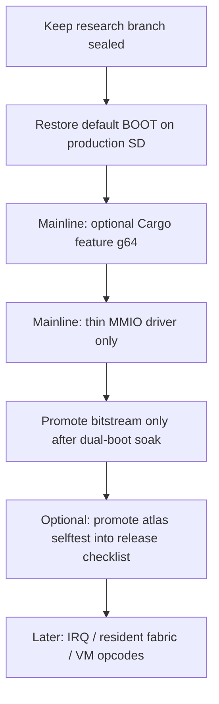

# G64 Findings and Mainline Integration Plan

Date: 2026-07-30
Branch context: `research/g64-phase-fabric-sidecar`
Physical evidence: `fpga/zynq/evidence/kairos_zynq_boot/run_20260730_175025/`

---

## 1. What we found

### 1.1 Mathematical shape maps cleanly to fabric

Canonical `gphase_core` produces a closed atlas:

| Class | Count |
|-------|-------|
| IDENTITY | **52** |
| REFLECTION | **12** |
| ERROR | **0** |

All **64** ordered triples `(a,b,c)` classify with no unexplained residue. Host oracle and on-board hardware reported the same census.

### 1.2 Hardware sidecar works beside G1P (non-invasive)

On COM12 (`run_20260730_175025`):

| Check | Result |
|-------|--------|
| G1P still @ `0x40000000` | PASS (`0x47504C34` / `0x00020000`) |
| G64 @ `0x40001000` | PASS (`0x47363453` G64S / `0x00010000`) |
| `g64 compose` | **16/16 PASS** (HW vs software) |
| `g64 reflect` | **4/4 PASS** |
| `g64 atlas` | **52/12/0 PASS** (`hw==gphase_core`) |
| `g64 benchmark` | **8/8** atlas iterations |
| Shell live after ops | PASS |

So the first research question is answered for the **conservative polled sidecar**: the algebra is realizable in PL without replacing the OS, G1P, UART, or DDR boot path.

### 1.3 What was *not* proven by this gate

- Spatial "64 independent live lanes" max-fit synthesis (resource/timing sweep still a separate study)
- G64 completion IRQ delivery
- HP/ACP DDR master paths
- Silent HW mutation of software process state / transition authority
- Default production image permanently shipping `g64-research` commands

### 1.4 Operational lesson

Research and production boots must stay **separately named**. After the G64 gate, restore the default feature BOOT so the board is not left on an experimental image. Staged restore:

- Package: `fpga/zynq/research/g64_phase_fabric_sidecar/RESTORE_DEFAULT_BOOT/BOOT.BIN`
- Source: `BOOT_PZ7020_FEATURE_TEST.BIN`
- SHA-256: `e17a3ac5b16deac3688bd93cde6048f583b680ebc6b8099edc701682d1e8344b`
- Script: `scripts/restore_default_pz7020_boot.ps1` (copies to SD root; **no harness**)

---

## 2. How to integrate the 64 into main (recommended path)

Do **not** merge the research branch wholesale into production in one step. Integrate in layers.

### Phase A — Preserve (now)

1. Keep G64 research artifacts and `run_20260730_175025` evidence intact.
2. Restore **default** `BOOT_PZ7020_FEATURE_TEST` to the production microSD (no test harness required).
3. Keep G64 research BOOT / bit under `research/g64_phase_fabric_sidecar/` only.

### Phase B — Software mainline (low risk)

Promote into `main` / `feature/pz7020-completion` **only**:

| Item | Rule |
|------|------|
| `gphase_core` | Already mainline — remains sole algebra authority |
| Oracle emit (`zynq_oracle` / JSON) | OK as host tooling |
| `board/zynq7000/g64.rs` | OK behind feature flag |
| Shell `g64 …` | **Opt-in only** (`g64-research` or rename to `g64`) |
| Default `kairos_zynq` bin | Must build **without** G64 commands unless feature enabled |
| Hard-fail compare HW vs software | Keep — never warn-only PASS |

Default production behavior stays identical to today's sealed feature image.

### Phase C — Bitstream / BOOT mainline (medium risk)

Only after a deliberate promotion checklist:

1. Address Editor confirms G64 window (`0x40001000`) and G1P untouched.
2. Post-route util/timing with G1P+G64 still positive slack at 100 MHz.
3. Research BOOT and default BOOT both boot on the same board back-to-back.
4. Release package uses **new** names first (`BOOT_G64_v0.x.BIN`), then optionally becomes the new default after soak — do not silently overwrite the sealed feature BOOT in place.

Conservative recommendation: **ship G64 in the PL bitstream early**, keep **software commands feature-gated** until operators want them in the everyday shell.

### Phase D — Product semantics for "the 64"

Once mainline accepts the sidecar:

| Use | Integration |
|-----|-------------|
| Atlas selftest | `g64 atlas` (or `g1p`-adjacent `phase atlas`) in bring-up checklist |
| Compose/reflect offload | Optional accel for hot paths that already call `gphase_core` |
| Masks as topology health | Expose identity/reflection/error masks to StateClock / audit later |
| Resident 64-cell fabric | **Not** first merge — research-only until protocol for legal transitions exists |
| VM opcodes (`COMPOSE`/`REFLECT`/…) | Roadmap only after polled accel is boringly stable |

### Phase E — What stays out of main for now

- Max-fit lane sweeps and pblock 8x8 experiments
- ACP/HP DDR fabric masters
- Hardware as silent process-state authority
- Duplicated algebra tables in RTL testbenches (always regenerate from `gphase_core`)

---

## 3. Concrete merge checklist (when ready)

- [ ] Default SD restored to feature BOOT (SHA above)
- [ ] Research evidence `run_20260730_175025` committed/tagged
- [ ] PR 1: docs + oracle tooling only
- [ ] PR 2: `g64` driver + feature-gated commands (no default enable)
- [ ] PR 3: Vivado BD addon script + separately named research/release BOOT
- [ ] Soak: boot default, then G64 image, then default again on COM12
- [ ] Only then consider enabling G64 in the "default" BOOT name

---

## 4. Bottom line

**Finding:** The 64-triple Golden Phase atlas is physically real on PZ7020 as a polled PL sidecar beside G1P, bit-exact to `gphase_core` (52/12/0).

**Integration:** Treat G64 as an **optional accelerator + bring-up selftest**, not a second OS. Restore the default kernel BOOT for daily use; merge software behind a feature flag; promote the bitstream under a new BOOT name after soak; keep advanced fabric (resident authority, IRQ, DDR, VM opcodes) on the research track.
